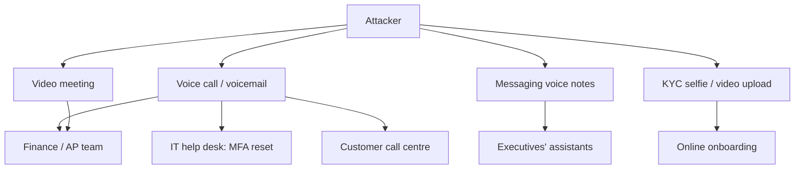

# The Synthetic-Media Fraud Threat Model

Voice cloning and real-time face swapping are now consumer software. A few seconds to minutes of clean audio — an earnings call, a conference talk, a podcast, a voicemail greeting — can be enough to produce a convincing clone of a speaker. Real-time video tools can map one face onto another during a call. None of this needs a research lab.

Fraudsters use these tools to make old scams more convincing. Business email compromise becomes a phone call from the "CFO". A grandparent scam becomes a call in a grandchild's voice. Remote identity checks become a contest between a liveness system and a face generated or injected on the attacker's device. This book is about defending against those scams, and its main argument is simple: **you cannot rely on people or detectors to hear or see the fake. You design processes where a convincing fake is not enough.**

## What is new and what is not

| Element | Before generative AI | Now |
|---|---|---|
| Pretext | Email from a look-alike domain | Live voice or video of a known person |
| Urgency and secrecy | "Confidential acquisition, act today" | Same, delivered by the "boss" |
| Payment rail | Wire transfer, gift cards, crypto | Same |
| Identity checks | Photo of ID, selfie | Selfie video with liveness, defeated by injection |
| Scale | Manual social engineering | Automated, multilingual, many targets |

The payment and identity steps are where defenders have the most control. The fake call is only the delivery mechanism for a request that should never succeed on a call alone.

## Threat model

Map assets, attackers and channels.

**Assets:** funds (wire, payroll, vendor payments), credentials and MFA resets, sensitive data, customer accounts (account takeover through a call centre), new accounts opened in someone else's name.

**Attackers:** organised fraud groups running business email compromise; opportunistic scammers targeting families; account-takeover crews targeting call centres; and identity-fraud operations targeting onboarding.

**Channels:**

**Attack prerequisites:** a voice or face sample of the impersonated person, knowledge of internal names and processes (from social media, leaked data or a prior email compromise), and a plausible reason for urgency.

## Trust assumptions that break

- "I recognise the voice." Recognition is no longer authentication.
- "I saw them on video." Real-time face swaps and pre-recorded segments exist.
- "Several colleagues were on the call." In the widely reported 2024 Hong Kong case, the other participants were reportedly fakes too.
- "The caller ID matched." Caller ID can be spoofed.
- "The selfie passed liveness." Liveness can be bypassed by injecting synthetic video into the capture pipeline.

Each broken assumption needs a replacement control that does not depend on the medium being genuine.

## Worked example

> **Execution status:** not executed in this book's CI; the commands and code below are illustrative. Verify locally in an authorised lab before relying on them, and check tool flags against your installed versions.

Run a one-hour synthetic-media exposure assessment for one business process, such as vendor bank-detail changes.

1. Write down the process as it actually runs today, including who can approve, by what channel, and any exceptions ("the CEO can authorise urgent payments by phone").
2. For each step, ask: if the request arrived by a perfect fake voice or video of the authorising person, would it succeed? Mark yes/no.
3. Inventory public audio and video of the people whose authority is used in the process (search your company website, video platforms and podcast feeds). Record approximate total minutes.
4. List the channels from the diagram that reach the process owners.
5. For every "yes" in step 2, propose a control that is independent of voice or video (chapter 3 has a menu).
6. Agree a test: a tabletop or an authorised simulation using a benign scenario, with HR and legal approval. Do not clone a real executive's voice without their written consent.

The output is a one-page table: step, current control, would a fake succeed, replacement control, owner.

## Common pitfalls

- Treating deepfake fraud as a detection problem rather than a process problem.
- Training staff to "listen for artefacts", which gets harder every model release.
- Leaving exception paths ("urgent CEO requests") that bypass normal approvals.
- Assuming only senior executives are impersonated; IT help desks and family members are frequent targets.
- Running simulations with real executives' cloned voices without consent and legal review.

## Exercises

1. Complete the exposure table above for two processes: vendor payment changes and help-desk MFA resets.
2. Estimate the public audio available for your five most senior executives and note which sources you control.
3. List every exception path in your payment policy and identify who can trigger each.

## Further reading

- FBI IC3 public service announcements on criminal use of generative AI for fraud (2024), [ic3.gov](https://www.ic3.gov/).
- FinCEN alert on fraud schemes involving deepfake media targeting financial institutions (November 2024), [fincen.gov](https://www.fincen.gov/).
- Sibling books: **dprk-crypto-threat-operations** for social engineering at scale, **adversarial-ml-security-classifiers**.
