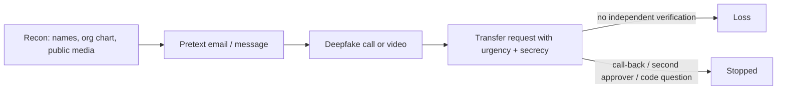

# What Reported Incidents Teach

Public reporting on deepfake fraud is incomplete. Most victims do not disclose, many figures come from police statements or press interviews, and details are often second-hand. Still, the reported cases share patterns that are useful for defence. This chapter summarises a handful, attributes figures to reports, and separates what was observed from what was inferred.

## Case summaries

| Year (reported) | Setting | Medium | Reported loss | Source of report |
|---|---|---|---|---|
| 2019 | UK subsidiary of a German energy company | Phone call imitating parent-company chief executive | ~€220,000 | Wall Street Journal, citing the insurer Euler Hermes |
| 2020 (reported 2021) | Bank in the UAE | Phone call imitating a company director, plus emails | ~US$35M (part of a larger scheme) | Forbes, citing court documents |
| 2024 | Hong Kong office of engineering firm Arup | Multi-person video conference with deepfaked senior staff | ~HK$200M (~US$25M) over multiple transfers | Hong Kong police statements; Arup confirmed it was the victim |
| 2024 | WPP | Voice clone and video footage in a meeting set up from a fake account | None reported; attempt failed | The Guardian, citing an internal email |
| 2024 | Ferrari | Messages and a call imitating the CEO | None; executive asked a verification question the caller could not answer | Bloomberg |
| 2024 | LastPass | Voice messages imitating the CEO via messaging app | None; employee reported it | LastPass company blog |

The Hong Kong case is the one most cited. According to police statements reported at the time, the employee initially suspected a phishing email, but was reassured by a video call in which several participants appeared to be colleagues, including the CFO. The transfers were made across 15 transactions. Treat those details as reported, not independently verified.

## Patterns

**1. The fake medium supports a classic pretext.** Every case is business email compromise or authority fraud with better props. Secrecy ("confidential transaction") and urgency recur.

**2. Multi-channel orchestration.** Email or messaging sets the scene; the call or video removes doubt. Defences that inspect one channel miss the combination.

**3. Recognition was the failed control.** Victims who lost money trusted the face or voice. Victims who stopped the fraud used something else: the WPP and LastPass targets noticed an unusual channel and context; the Ferrari executive asked a question only the real CEO could answer.

**4. Process exceptions enable large losses.** Large transfers without independent call-back to a known number, or with authority concentrated in one person, turned a convincing call into a loss.

## Observation versus attribution

Reports often say "AI was used" without technical evidence. In some cases investigators inferred deepfakes from victim descriptions. When you build training or policy from incidents, record:

- what the victim observed (voice, video, number of participants, channel),
- what investigators confirmed (transfers, accounts, recovered artefacts),
- what is inferred (the specific tool, whether it was real-time or pre-recorded).

This matters because defences should not depend on the exact technique. Whether the CFO in the Hong Kong call was real-time or pre-recorded, an independent call-back would have defeated both.

## Regulatory signals

Several authorities have responded. In February 2024 the US Federal Communications Commission ruled that AI-generated voices in robocalls count as "artificial" voices under the Telephone Consumer Protection Act, after a cloned-voice robocall imitating President Biden targeted New Hampshire voters in January 2024. FinCEN issued an alert in November 2024 describing deepfake-enabled fraud against financial institutions and listing red flags. The FBI has issued public warnings about criminal use of generative AI, including impersonation of senior officials in 2025.

## Worked example

> **Execution status:** not executed in this book's CI; the commands and code below are illustrative. Verify locally in an authorised lab before relying on them, and check tool flags against your installed versions.

Turn incident reports into a tabletop exercise for your finance team.

1. Pick the Hong Kong case pattern. Write a scenario adapted to your organisation: a message from the "CFO" about a confidential acquisition, followed by a video meeting invitation.
2. Define injects: the meeting has three participants; the "CFO" asks for transfers to a new beneficiary in two tranches; a "colleague" on the call confirms.
3. Run the tabletop with finance, treasury, the executive assistant team and security. Ask at each inject: what does policy require now, and what would people actually do?
4. Record every point where the process relies on recognising a person.
5. Score the outcome: at which step would the fraud have been stopped, and by which control?
6. Produce three actions with owners, for example "call-back to directory number required for any new beneficiary above threshold".

Use fictional names in materials, and get HR approval before any live simulation.

## Common pitfalls

- Quoting incident figures as precise facts rather than as reported.
- Building training around detecting the artefacts seen in one case.
- Ignoring failed attempts, which are the best evidence of which controls work.
- Assuming your organisation is too small to be targeted; consumer and SME cases are common but rarely reported.
- Sharing a real incident's internal details in training without permission.

## Exercises

1. Write a one-page summary of one public case, separating observed, confirmed and inferred facts, with sources.
2. Run the tabletop above and list the controls that would have stopped the fraud at each step.
3. Collect any attempted impersonations your organisation saw last year and classify them by channel and target role.

## Further reading

- Contemporary coverage of the Arup case (CNN, Financial Times, The Guardian, May 2024) and Hong Kong police statements (February 2024).
- FCC Declaratory Ruling on AI-generated voices under the TCPA (February 2024), [fcc.gov](https://www.fcc.gov/).
- FinCEN alert on deepfake media fraud schemes (2024), [fincen.gov](https://www.fincen.gov/).
- Sibling book: **dprk-crypto-threat-operations** for state-linked social engineering.
