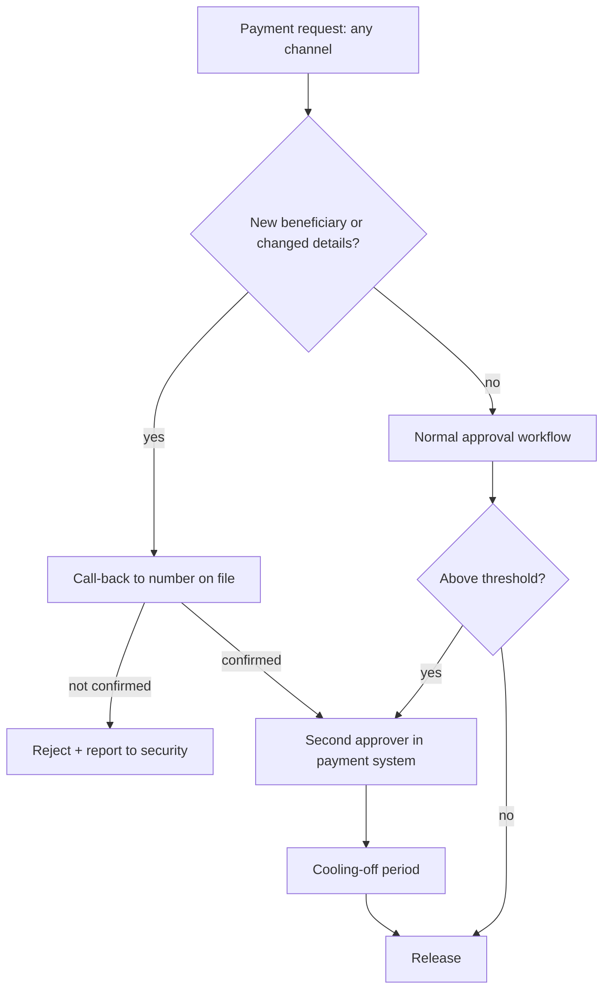

# Process Controls That Design Fraud Out

The most effective defence against a perfect fake voice is a process in which a voice was never sufficient. This chapter gives a menu of controls for payments, help desks, executive communications and families, and explains how to test them without cloning anyone.

## Principles

1. **Authenticate the request, not the medium.** Verify through a channel the attacker does not control, initiated by you.
2. **Separate duties.** No single person, however senior, can authorise and release a high-value or unusual payment.
3. **Remove exceptions.** "The CEO can override in emergencies" is the attack.
4. **Make verification normal.** If call-backs are routine, nobody feels they are insulting the boss.
5. **Slow down the risky path.** Time delays on new beneficiaries defeat urgency.

## Control menu

| Process | Control | What it defeats |
|---|---|---|
| Payments to new beneficiaries | Call-back to a number from the vendor master or directory, never from the request | Fake caller, spoofed caller ID |
| Bank-detail changes | Dual approval plus a cooling-off period before first payment | Urgency, single-person compromise |
| High-value transfers | Two approvers in the payment system; thresholds enforced by the system, not by policy text | Authority impersonation |
| Executive requests | Shared verification phrase or challenge questions agreed in person; refresh periodically | Voice or video impersonation |
| Video meetings | Join via calendar invite from the corporate directory; verify unexpected meetings out of band | Fake meeting set-ups |
| IT help desk | MFA reset requires manager approval in a ticketing system or in-person/ID verification; no resets on caller voice alone | Voice-based account takeover |
| Call centres | Step-up authentication via app push or one-time code; voice biometrics only as one signal | Cloned customer voices |
| Families | A family safe word; hang up and call back on a known number | "Grandchild in trouble" scams |

Voice biometrics deserve a note. Several banks used voiceprints as a password. Journalists and researchers have reported getting past such systems with cloned voices. If you use voice biometrics, treat them as a risk signal combined with other factors, and check that your vendor tests against synthetic speech.

## Verification phrases done properly

Code words work only if they are handled like secrets:

- Agree them in person or through an authenticated channel, never by email.
- Use a challenge-response pair rather than a single word, so overhearing one exchange does not give away both halves.
- Never say the word first; the caller must offer it.
- Rotate after use in a real incident and periodically.
- Have a duress variant if the context warrants it.

A simple alternative, used in the Ferrari case as reported, is a personal question whose answer is not public.

## Fitting controls into the payment flow

## Worked example

> **Execution status:** not executed in this book's CI; the commands and code below are illustrative. Verify locally in an authorised lab before relying on them, and check tool flags against your installed versions.

Implement and test call-back verification for vendor bank-detail changes. This uses process and configuration, not AI tools, because the control must not depend on detecting fakes.

1. **Inventory.** Export the vendor master list. Confirm each vendor has a phone number captured at onboarding from an independent source (contract, website), not from an invoice.
2. **System enforcement.** In your ERP or payment platform, configure bank-detail changes to require a second user's approval and to place the vendor on hold for a set period (for example 48 hours). Most platforms support maker-checker workflows; the point is that the system enforces it.
3. **Call-back script.** Write a short script: call the number on file, ask the vendor to confirm the change request reference, and record the name of the person who confirmed. The script never uses contact details from the request.
4. **Logging.** The approver attaches the call-back record to the change ticket.
5. **Test (authorised).** With finance leadership's written approval, the security team submits a benign test change request from an external address with a plausible pretext. Measure whether the call-back happens and whether the system hold applies.
6. **Review.** Report the outcome without naming individuals, fix any gap, and repeat quarterly with a different pretext (email, voicemail, messaging).

Success is measured by the system log: hold applied, second approver recorded, call-back attached. A person's opinion that the request "seemed fine" is not part of the control.

## Reducing exposure

You cannot remove all public audio of executives, but you can:

- Avoid long, clean, isolated voice recordings where they add little value.
- Make voicemail greetings generic.
- Brief executives' assistants, who are often the actual target.
- Publish, internally, "we will never ask you to do X by phone or video" statements from leadership.

## Common pitfalls

- Call-backs to the number in the suspicious email or signature.
- Code words shared over email or chat.
- Thresholds that attackers learn and stay just below; also review unusual patterns of smaller payments.
- Help desks that reset MFA for "travelling executives" on voice alone.
- Controls that exist in policy documents but not in the payment system's configuration.

## Exercises

1. Map one payment process onto the flow diagram and list every place a single person can bypass it.
2. Design a challenge-response verification scheme for your leadership team, including distribution and rotation.
3. Run an authorised simulated bank-detail change and measure whether each control fired, using system logs as evidence.

## Further reading

- FBI IC3 guidance on business email compromise, [ic3.gov](https://www.ic3.gov/).
- UK National Cyber Security Centre guidance on phishing and business email compromise, [ncsc.gov.uk](https://www.ncsc.gov.uk/).
- FinCEN deepfake alert (2024) red-flag indicators.
- Sibling book: **ai-agent-wallet-security** for transaction approval design.
