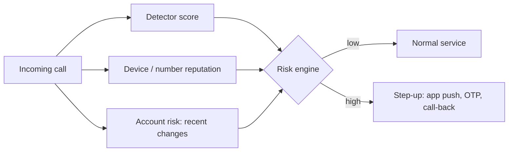

# Detecting Synthetic Voice and Video, and the Limits

Detection tools are useful, but they are not a control you can rely on alone. This chapter explains how audio and video deepfake detectors work, why their accuracy drops in real conditions, and how to evaluate a detector before you trust it.

## How detectors work

**Audio anti-spoofing** models classify an utterance as bona fide or spoofed. They learn artefacts of synthesis and conversion: spectral irregularities, phase information, vocoder fingerprints, unnatural prosody. Graph-attention models such as AASIST (Jung et al., ICASSP 2022) and self-supervised front ends (wav2vec 2.0 or similar features fed into a classifier) are common research baselines. The ASVspoof challenge series (2015 onwards, with ASVspoof 5 in 2024) provides standard datasets and metrics.

**Video deepfake detectors** look for blending boundaries, inconsistent lighting, unnatural blinking or lip-sync, and frequency-domain artefacts. FaceForensics++ (Rössler et al., ICCV 2019) and the Deepfake Detection Challenge (Meta and partners, 2020) are standard references.

**Human-in-the-loop cues** for live calls: asking the person to turn their head fully sideways, pass a hand in front of the face, or answer an unexpected question. These raise the bar for some real-time tools but are not reliable as models improve.

## Why lab accuracy does not transfer

| Factor | Effect |
|---|---|
| Unseen generators | Detectors trained on known systems miss new ones |
| Channel effects | Telephone codecs, compression and packet loss remove artefacts and add noise |
| Short samples | A few seconds of speech gives little evidence |
| Adversarial post-processing | Adding noise, re-recording through a speaker, or targeted perturbations |
| Base rates | Even a low false-positive rate swamps analysts when nearly all calls are genuine |

Müller et al., "Does Audio Deepfake Detection Generalize?" (Interspeech 2022), released an "In-the-Wild" dataset of real and fake speech from public figures and showed that models performing well on ASVspoof degraded sharply on it. In the Deepfake Detection Challenge, the top model's accuracy on the held-out black-box set was reported at around 65%, far below its public-leaderboard score. The pattern is consistent: detectors are brittle outside their training distribution.

## The base-rate problem

Suppose a call centre handles 100,000 calls a day and 10 are cloned voices. A detector with 95% true-positive rate and 1% false-positive rate flags about 9.5 fakes and about 1,000 genuine callers. Precision is under 1%. Detection can still be useful as one risk signal feeding step-up authentication, but it cannot be a gate on its own.



## Worked example

> **Execution status:** not executed in this book's CI; the commands and code below are illustrative. Verify locally in an authorised lab before relying on them, and check tool flags against your installed versions.

Evaluate an audio anti-spoofing model on in-distribution and out-of-distribution data before buying or deploying anything. Use datasets under their licence terms.

1. Get data: ASVspoof 2019 LA evaluation set (in-distribution for many public models) and the In-the-Wild dataset from Müller et al. (out-of-distribution).
2. Get a model: clone a public baseline such as the AASIST repository and use its released pre-trained weights, or obtain a vendor's evaluation API under contract.
3. Score every file and save `label,score` pairs (label 1 = bona fide).
4. Compute the equal error rate (EER), the standard ASVspoof metric:

```python
import numpy as np
from sklearn.metrics import roc_curve
d = np.loadtxt("scores_itw.csv", delimiter=",", skiprows=1)
fpr, tpr, _ = roc_curve(d[:, 0], d[:, 1])
fnr = 1 - tpr
i = np.nanargmin(np.abs(fnr - fpr))
print(f"EER = {100 * (fpr[i] + fnr[i]) / 2:.1f}%")
```

5. Simulate the channel: pass a sample through a narrowband telephone codec and re-score.

```bash
for f in sample/*.flac; do
  ffmpeg -loglevel error -i "$f" -ar 8000 -ac 1 -c:a pcm_mulaw "tel/$(basename "$f" .flac).wav"
done
```

6. Report EER for the three conditions (in-distribution, in-the-wild, telephone) and compute expected precision at your traffic volume and estimated fraud rate.

The numbers decide where the detector fits: typically as a risk signal, not as an automatic block.

## Common pitfalls

- Buying on vendor accuracy figures measured on the vendor's own test set.
- Evaluating on clean studio audio when your channel is a phone line.
- Ignoring the base rate and drowning staff in false positives.
- Training staff to rely on "tells" that the next generation of tools removes.
- Treating a "real" verdict as authentication.

## Exercises

1. Reproduce the EER calculation on a public model for ASVspoof and In-the-Wild data and explain the gap.
2. Measure how EER changes after telephone-codec simulation and after re-recording through a speaker and microphone.
3. Compute precision for your organisation's call volume with three assumed fraud rates, and write a recommendation on how to use the detector.

## Further reading

- [ASVspoof challenge](https://www.asvspoof.org/).
- Müller et al., "Does Audio Deepfake Detection Generalize?", Interspeech 2022.
- Jung et al., "AASIST: Audio Anti-Spoofing using Integrated Spectro-Temporal Graph Attention Networks", ICASSP 2022.
- Rössler et al., "FaceForensics++: Learning to Detect Manipulated Facial Images", ICCV 2019.
- Dolhansky et al., "The DeepFake Detection Challenge (DFDC) Dataset", 2020.
- Sibling book: **adversarial-ml-security-classifiers** for evasion of detectors.
