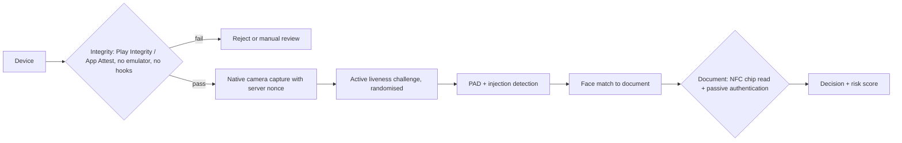

# KYC, Liveness and Injection Attacks

Remote onboarding asks a person to show an identity document and a live face. Generative tools give fraudsters two ways to beat it: present something fake to the camera (a presentation attack), or bypass the camera entirely and feed synthetic video into the app (an injection attack). This chapter explains both, the standards that test them, and the design choices that make onboarding robust.

## Two attack classes

| Class | How it works | Examples | Primary defence |
|---|---|---|---|
| Presentation attack | An artefact is shown to a real camera | Printed photo, screen replay, mask, deepfake video on a second screen | Presentation attack detection (PAD), liveness |
| Injection attack | Synthetic or replayed media enters the pipeline without passing through the physical camera | Virtual camera drivers, emulators, hooked apps, tampered SDK traffic | Device and capture integrity, injection attack detection |

Liveness checks were designed largely for presentation attacks. Injection attacks sidestep them: if the video stream itself is synthetic, a real-time face generator can blink, turn and smile on request.

## Standards and testing

- **ISO/IEC 30107-3** defines how presentation attack detection is tested and reported, including metrics such as APCER (attack presentations wrongly accepted) and BPCER (bona fide presentations wrongly rejected). Independent labs test products against it; vendors often quote "level 1" or "level 2" conformance from such testing.
- **CEN/TS 18099** (2024) is a European technical specification on biometric data injection attack detection, filling the gap left by PAD standards.
- **NIST SP 800-63** (Digital Identity Guidelines, revision 4) sets identity-proofing assurance levels and covers remote proofing requirements.
- **NIST's face analysis evaluations** (formerly FRVT, now FRTE/FATE) include PAD and morphing evaluations useful for vendor comparison.

Ask vendors which attack classes their certification covered. A PAD certificate says little about injection.

## Design for capture integrity



Key choices:

1. **Native app capture over web capture** where possible, because mobile platforms offer attestation (Google Play Integrity API, Apple App Attest) that makes emulators and tampered apps detectable.
2. **Server-issued nonces and randomised challenges** bound to the session, so a pre-rendered video cannot match.
3. **Read the document chip.** Modern passports and many ID cards contain an ICAO 9303 chip with a signed photo. Reading it over NFC and verifying the signature (passive authentication) gives a trusted reference image that a deepfake of a printed ID cannot forge.
4. **Detect virtual cameras and emulators** on web flows through browser and device signals, accepting this is an arms race.
5. **Correlate across sessions.** Many fraud operations reuse the same synthetic face or device across applications; duplicate detection on faces and device fingerprints catches this.
6. **Manual review for edge cases**, with reviewers trained on what injection artefacts look like.

## Worked example

> **Execution status:** not executed in this book's CI; the commands and code below are illustrative. Verify locally in an authorised lab before relying on them, and check tool flags against your installed versions.

Assess an onboarding flow you own, in a test environment, for injection resilience. Only test systems you are authorised to test.

1. **Map the flow.** Record whether capture is in a native app, a web page or both, and which SDK performs liveness.
2. **Check attestation.** In the native app, confirm the backend verifies an integrity token on every onboarding session. Inspect the server code or logs for the verdict fields, not just the client call.
3. **Virtual camera test (web flow).** On a test machine, install OBS Studio and enable its virtual camera. Feed a recorded video of a consenting tester. Observe whether the flow detects the virtual device, and whether the session is flagged in backend logs.
4. **Replay test.** Re-submit a previously captured session payload through an intercepting proxy (for example Burp Suite or mitmproxy) in the test environment. Confirm the server rejects it because the nonce is stale.

```bash
mitmproxy --mode regular --listen-port 8080   # route the test device through it
# Save a flow, then replay it client-side:
mitmdump -nC saved_onboarding.flow
```

5. **Document chip test.** Confirm whether the flow reads the chip and verifies its signature, or only photographs the document.
6. **Record results** in a matrix: test, expected behaviour, observed behaviour, evidence (log line or screenshot), fix owner.

Do not generate synthetic faces of real people for testing; use consenting testers or clearly synthetic test identities provided by your vendor.

## Common pitfalls

- Relying on a PAD certificate as proof of injection resistance.
- Verifying device attestation on the client only, where the result can be forged.
- Static liveness prompts ("blink twice") that can be pre-rendered.
- Photographing document chips' printed data instead of reading the signed chip.
- No cross-application duplicate detection, missing industrial-scale fraud.
- Over-tight thresholds that push genuine customers, especially those with older devices, into failure.

## Exercises

1. Build the test matrix above for one onboarding flow and run the virtual camera and replay tests in a staging environment.
2. Ask your liveness vendor which ISO/IEC 30107-3 and injection tests they passed, at what level, and with which lab; summarise the gaps.
3. Prototype NFC chip reading and passive authentication with an open-source library on a test passport you own, and compare the chip photo to a selfie match score.

## Further reading

- ISO/IEC 30107-3, Biometric presentation attack detection — Testing and reporting.
- [NIST SP 800-63 Digital Identity Guidelines](https://pages.nist.gov/800-63-4/).
- [ICAO Doc 9303](https://www.icao.int/publications/doc-series/doc-9303), machine readable travel documents.
- [Google Play Integrity API](https://developer.android.com/google/play/integrity) and [Apple App Attest](https://developer.apple.com/documentation/devicecheck).
- Sibling book: **mobile-crypto-malware** for hooking and emulator techniques on mobile.
